# Overcoming spectrophotometer measurement limitations

*Reconstructing unreliable spectral regions: a case study with Game Boy Color measurements and an X-Rite ColorMunki Photo*

A reflectance spectrum describes how much light a surface reflects at each wavelength. To measure it, we use a spectrophotometer, but not every part of its reported spectrum is necessarily reliable. In the Game Boy Color measurements examined here, the X-Rite ColorMunki Photo produces unreliable readings below about 440 nm and noisy readings above 700 nm.

The aim of this article is to determine how to reconstruct the unreliable part of these spectra from the usable measurements. We first examine the affected regions and their influence on the colour coordinates calculated from the spectrum. We then compare four approaches, from removing suspect values to extrapolating from reliable bands, and assess their assumptions and limitations. Without an independent reference measurement, this comparison cannot establish the true spectrum.

The article is written for two audiences:

- If you only want the answer, read the **In short** lines at the start of each section and the [Conclusions](#7-conclusions).
- If you want to check or reuse the analysis, every number, table and figure comes from a script you can run yourself.

## Index

- [1 Introduction](#1-introduction)
   - [1.1 From spectrum to XYZ](#11-from-spectrum-to-xyz)
   - [1.2 The problem](#12-the-problem)
   - [1.3 Why it matters](#13-why-it-matters)
   - [1.4 Roadmap](#14-roadmap)
- [2 Data and evaluation](#2-data-and-evaluation)
   - [2.1 Measurements](#21-measurements)
   - [2.2 Metrics](#22-metrics)
   - [2.3 Noise floor](#23-noise-floor)
- [3 The band at or below 420 nm](#3-the-band-at-or-below-420-nm)
   - [3.1 What the data show](#31-what-the-data-show)
   - [3.2 Cleaning](#32-cleaning)
- [4 The band from 420 to 440 nm](#4-the-band-from-420-to-440-nm)
   - [4.1 Baseline leak](#41-baseline-leak)
   - [4.2 Shape of the drop](#42-shape-of-the-drop)
   - [4.3 Reliability zones](#43-reliability-zones)
   - [4.4 Choosing the cutoff](#44-choosing-the-cutoff)
- [5 Reconstructing the region below the cutoff](#5-reconstructing-the-region-below-the-cutoff)
   - [5.1 Truncation](#51-truncation)
   - [5.2 Gaussian extrapolation](#52-gaussian-extrapolation)
   - [5.3 Hold](#53-hold)
- [6 Comparison and choice](#6-comparison-and-choice)
- [7 Conclusions](#7-conclusions)
- [8 Limitations and open questions](#8-limitations-and-open-questions)
- [9 References](#9-references)

## 1 Introduction

> **In short:** unreliable spectral readings also affect the colour coordinates calculated from them. We first explain that calculation, then examine the suspect regions to decide where reconstruction is needed.

### 1.1 From spectrum to XYZ

The instrument returns a **reflectance factor** $R(\lambda)$ for each wavelength band. 0 means the surface reflects nothing and 1 means it reflects as much as a perfect white reference. Our data have 106 bands from 380 to 730 nm, one every 3.33 nm.

To turn a spectrum into a colour, we multiply it by:

- an **illuminant** $S(\lambda)$, the light the surface is viewed under. We use CIE D50.
- the three **colour matching functions** $\bar{x}(\lambda)$, $\bar{y}(\lambda)$, $\bar{z}(\lambda)$ of the CIE 1931 2° standard observer, which describe how the eye responds to each wavelength.

We then add up the products over all bands:

$$
X = k\sum_i R(\lambda_i)\,S(\lambda_i)\,\bar{x}(\lambda_i),\qquad
Y = k\sum_i R(\lambda_i)\,S(\lambda_i)\,\bar{y}(\lambda_i),\qquad
Z = k\sum_i R(\lambda_i)\,S(\lambda_i)\,\bar{z}(\lambda_i)
$$

$$
k = \frac{1}{\sum_i S(\lambda_i)\,\bar{y}(\lambda_i)}
$$

The constant $k$ scales the result so that a **perfect reflector** ($R = 1$ at every wavelength) has $Y = 1$. All XYZ values in this article are on this 0–1 scale.

Each wavelength band contributes to all three coordinates. Its contribution to X is its measured reflectance $R(\lambda_i)$ multiplied by $k\,S(\lambda_i)\,\bar{x}(\lambda_i)$. This multiplier is the band's **weight for X**. The weights for Y and Z use $\bar{y}$ and $\bar{z}$ instead. The weights depend on the chosen illuminant and observer, not on the measured surface.

A weight tells us how sensitive a coordinate is to a reflectance error in that band: the same reflectance error produces a larger error in X where the weight for X is larger. The band's actual contribution, however, depends on both its weight and its reflectance. This distinction helps us assess which unreliable bands most affect the calculated colour.

For the calculation, the illuminant and observer data must be evaluated at the same wavelengths as the measurements. Our scripts first resample D50 to 1 nm with colour-science, then linearly interpolate D50 and the colour matching functions to the 106 measured band centres.

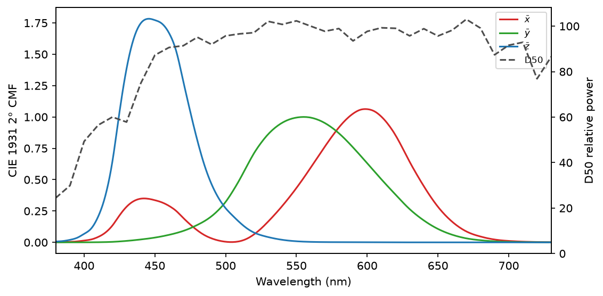

*Figure 1. CIE 1931 2° colour matching functions (left axis) and D50 relative power (right axis). Produced by `scripts/1_spectrum_to_xyz.py`.*

### 1.2 The problem

Figure 2 shows the 32 readings of the white ramp, from the darkest (0) to the brightest (31) level of the Game Boy Color screen.

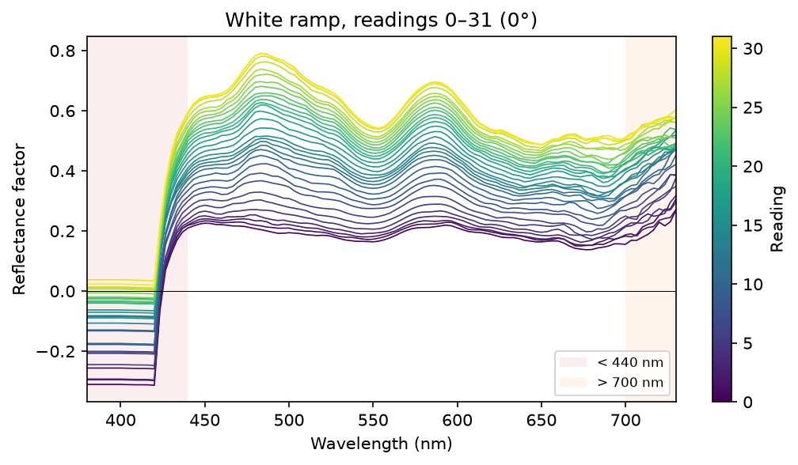

*Figure 2. Raw spectra of the white ramp, instrument at 0°. Produced by `scripts/1_spectrum_to_xyz.py`.*

Two regions are clearly wrong:

- **Below 440 nm.** Up to 420 nm every spectrum is a flat line, mostly below zero. A negative reflectance is physically impossible. Between 420 and 440 nm the curves climb steeply from that line to the real signal. Section 3 and section 4 study these two parts separately.
- **Above 700 nm.** The curves become ragged and fan out.

### 1.3 Why it matters

Look again at Figure 1. The peak of $\bar{z}$ (446 nm) and the small blue lobe of $\bar{x}$ (442 nm) sit right at the edge of the bad region. Table 1 shows how much of each coordinate comes from the two unreliable regions.

*Table 1. Share of X, Y and Z coming from the bands below 440 nm and above 700 nm, reading 31, 0°, raw data. "Perfect reflector" is the theoretical $R = 1$ surface. Produced by `scripts/1_spectrum_to_xyz.py`.*

| Ramp | X < 440 | Y < 440 | Z < 440 | X > 700 | Y > 700 | Z > 700 |
|---|---:|---:|---:|---:|---:|---:|
| White | 2.2 % | 0.1 % | 11.9 % | 0.10 % | 0.03 % | 0.00 % |
| Red | 1.1 % | 0.1 % | 10.1 % | 0.13 % | 0.06 % | 0.00 % |
| Green | 0.8 % | 0.0 % | 5.3 % | 0.07 % | 0.02 % | 0.00 % |
| Blue | 2.7 % | 0.1 % | 9.3 % | 0.07 % | 0.02 % | 0.00 % |
| Yellow | 1.3 % | 0.1 % | 10.3 % | 0.13 % | 0.05 % | 0.00 % |
| Cyan | 2.5 % | 0.1 % | 10.5 % | 0.11 % | 0.03 % | 0.00 % |
| Magenta | 2.4 % | 0.1 % | 12.6 % | 0.11 % | 0.04 % | 0.00 % |
| Perfect reflector | 3.6 % | 0.1 % | 20.4 % | 0.11 % | 0.04 % | 0.00 % |

What the table tells us:

- **Below 440 nm matters.** For a surface that reflects evenly, one fifth of Z and 3.6 % of X come from the bands the instrument gets wrong. The measured screens show less, because the raw data are already wrong there. The perfect reflector shows what is at stake.
- **Y is almost unaffected** (0.1 %). Brightness is safe, while chromaticity (the hue and saturation) is not.
- **Above 700 nm does not matter** for colour. All three coordinates get at most 0.13 % from that region. The rest of the article ignores it.

### 1.4 Roadmap

1. Section 2 describes the data and how we judge a method.
2. Section 3 analyses the flat region up to 420 nm and introduces **cleaning**, the first step of every method.
3. Section 4 analyses the steep region from 420 to 440 nm and chooses a **cutoff**: the first band we trust.
4. Section 5 tests three ways to fill the region below the cutoff: **truncation**, **Gaussian extrapolation** and **hold**.
5. Section 6 compares all methods and picks one.

All the figures and tables are produced by the Python scripts in [scripts/](scripts/). See [scripts/README.md](scripts/README.md) to set them up and run them.

## 2 Data and evaluation

> **In short:** 672 spectra of a Game Boy Color, measured in three instrument orientations. We compare each method against the raw data with CAM16-UCS ΔE. After the cleaning described in section 3, five repeated readings per patch from an earlier session provide a historical repeatability reference of ΔE 0.82, not a significance threshold.

### 2.1 Measurements

| Item | Value |
|---|---|
| Handheld | Nintendo Game Boy Color |
| Instrument | X-Rite ColorMunki Photo (spectrophotometer), calibrated |
| Software | ArgyllCMS `spotread` |
| Screen protector | Present, not removed |
| Ramps | White, Red, Green, Blue, Yellow, Cyan, Magenta |
| Readings per ramp | 32 (levels 0 to 31 of the console's 5-bit colour) |
| Orientations | 0°, 90° and 180° (instrument rotated on the screen) |
| Spectral range | 380–730 nm, 106 bands, 3.33 nm step |
| Total | 3 orientations × 7 ramps × 32 readings = 672 spectra |

The raw data are in [`handhelds/Nintendo GBC/[2026-11-09][Pokefan531]/measurements/`](../../handhelds/Nintendo%20GBC/%5B2026-11-09%5D%5BPokefan531%5D/measurements/). The files `gbc-all-top.ods`, `gbc-all-middle.ods` and `gbc-all-bottom.ods` hold the 0°, 90° and 180° orientations.

> [!NOTE]
> **TODO:** add photos of the instrument placed on the screen at 0°, 90° and 180°.

### 2.2 Metrics

Every method changes the spectrum, so it also changes XYZ. We compare the XYZ of each method with the XYZ of the **raw data**, the spectra exactly as the instrument delivered them.

| Metric | What it measures |
|---|---|
| ΔX, ΔY, ΔZ | Signed difference, method minus raw, on the 0–1 scale |
| Δxy | Distance between the two points on the CIE 1931 xy chromaticity diagram |
| ΔE | Perceived colour difference in CAM16-UCS |

- **ΔE settings.** XYZ is multiplied by 100. The reference white is the perfect reflector under D50, computed on the same 106 bands. The adapting luminance is $L_A = 318.31$ cd/m², the background is $Y_b = 20$ and the surround is *Average*.
- **Reading ΔE.** As a practical guideline here, differences start to become visible above about ΔE 3. This is not a universal threshold: visibility depends on the colours and viewing conditions.
- **The raw data are not the truth.** They are just the common reference. ΔE tells us how much a method changes the colour. It does not tell us whether the change is correct. We judge correctness separately, with physical plausibility checks.
- **Swatches.** XYZ values calculated under D50 are converted to sRGB. Colours outside sRGB are clipped and marked with `*`.

For each method we report:

- one table per orientation for reading 31, the full-intensity colour;
- one table per ramp summarising all 32 readings.

### 2.3 Noise floor

A measured spectrum varies slightly from one acquisition to the next. To put the changes made by a reconstruction method in context, we estimate **repeatability** from repeated measurements of the same patch under the same acquisition conditions.

The source measurements were acquired on **9 May 2026**, in the report dated 13 May:

- [gbc-gamma1 2026-05-09.txt](../../handhelds/Nintendo%20GBC/%5B2026-05-13%5D%5BPokefan531%5D/measurements/gbc-gamma1%202026-05-09.txt).
- [gbc-gamma2 2026-05-09.txt](../../handhelds/Nintendo%20GBC/%5B2026-05-13%5D%5BPokefan531%5D/measurements/gbc-gamma2%202026-05-09.txt).

The [acquisition notes](../../handhelds/Nintendo%20GBC/%5B2026-05-13%5D%5BPokefan531%5D/measurements/README.md) identify the same physical Game Boy Color, a calibrated ColorMunki Photo and five readings per greyscale patch. Each file contains 32 blocks of five readings. These 320 historical spectra are used only for the repeatability estimate; they are not added to the 672 November spectra evaluated by the reconstruction methods.

**Preprocessing.** Before computing repeatability, we apply the cleaning described in [section 3.2](#32-cleaning) to every repeated spectrum: all bands up to and including **423.333 nm** and all negative reflectance values at any wavelength are set to zero. The first band retained is 426.667 nm, provided its value is non-negative. The source files are not modified.

**Calculation.** We integrate each cleaned reflectance spectrum under D50 with the CIE 1931 2° observer, exactly as in section 1.1. We do not use the XYZ or Lab columns already present in the exports. Each XYZ is converted to CAM16-UCS with the settings in section 2.2. For each file $f$ and patch block $p$, the five readings give ten distinct pairs:

$$
d_{f,p,a,b} = \left\|\mathbf{J}'_{f,p,a}-\mathbf{J}'_{f,p,b}\right\|_2,
\qquad 1 \leq a < b \leq 5
$$

Here $\mathbf{J}'$ denotes the three CAM16-UCS coordinates $(J',a',b')$, not lightness alone. Every comparison stays within one patch block in one file. We report the distances directly, without scaling them to a single-reading standard deviation.

*Table 2. Historical within-patch repeatability after section 3 cleaning. Each patch block contributes ten pairs. Produced by `scripts/2_noise_floor.py` from the two source files linked above.*

| Source | Patch blocks | Readings | Pairs | mean ΔE | p95 ΔE | max ΔE |
|---|---:|---:|---:|---:|---:|---:|
| gbc-gamma1 2026-05-09.txt | 32 | 160 | 320 | 0.37 | 0.78 | 1.33 |
| gbc-gamma2 2026-05-09.txt | 32 | 160 | 320 | 0.40 | 0.89 | 1.30 |
| All | 64 | 320 | 640 | 0.38 | 0.82 | 1.33 |

The pooled empirical 95th percentile is **ΔE = 0.82**. We use it below as a **historical repeatability reference after cleaning**. It describes differences between repeated readings after the bands through 423.333 nm and all negative values have been removed, not the repeatability of the unprocessed data, the uncertainty of a single reading or the accuracy of the instrument. The 640 pairs are not independent observations, because pairs within a block share readings. The method comparisons in sections 3, 5 and 6 remain against the raw November data, as defined in section 2.2; only the repeatability reference uses these cleaned historical spectra.

Repeatability varies by patch, so one pooled value does not describe every colour equally well. A change above 0.82 is larger than most observed historical repeat differences after cleaning; a change below it is not automatically noise. Neither result proves that a reconstruction is correct.

**Limits of this reference.** The repeated measurements cover greyscale patches in May, whereas the reconstruction analysis covers colour ramps in November. Session conditions may have changed, and repeatability for coloured patches is not established by these files. The reference is therefore a scale for comparison, not a verified noise floor for every November reading or a statistical significance threshold. Repeated acquisitions of the November colour patches would be needed to establish that directly.

## 3 The band at or below 420 nm

> **In short:** up to 420 nm the instrument returns a flat, mostly negative line that follows the brightness of the patch. It contains no spectral information, so we set it to zero.

### 3.1 What the data show

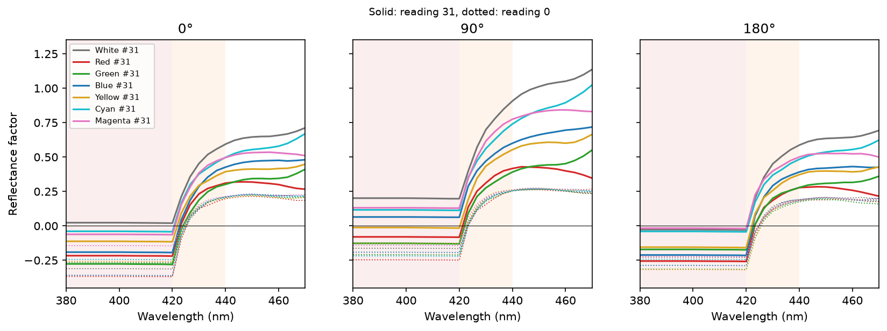

*Figure 3. Raw spectra between 380 and 470 nm for all ramps at reading 31 (solid) and reading 0 (dotted), one panel per orientation. Produced by `scripts/3_band_below_420.py`.*

*Table 3. Negative reflectance values per region, all ramps and readings. Produced by `scripts/3_band_below_420.py`.*

| Orientation | ≤ 420 nm | 423.3–436.7 nm | 440–700 nm | > 700 nm |
|---|---:|---:|---:|---:|
| 0° | 2834 / 2912 | 97 / 1120 | 0 / 17696 | 0 / 2016 |
| 90° | 2249 / 2912 | 0 / 1120 | 0 / 17696 | 0 / 2016 |
| 180° | 2912 / 2912 | 150 / 1120 | 0 / 17696 | 0 / 2016 |

We call **baseline** the mean of the bands at or below 420 nm in one spectrum.

*Table 4. Baseline statistics per spectrum. "Max spread" is the largest difference between bands inside one baseline. The last two columns are correlations of the baseline with the reflectance at 450 nm and with Y. Produced by `scripts/3_band_below_420.py`.*

| Orientation | Range | Negative spectra | Max spread within baseline | corr(baseline, R450) | corr(baseline, Y) |
|---|---:|---:|---:|---:|---:|
| 0° | -0.417 … +0.037 | 218 / 224 | 0.0044 | 0.83 | 0.68 |
| 90° | -0.266 … +0.200 | 173 / 224 | 0.0044 | 0.94 | 0.75 |
| 180° | -0.370 … -0.011 | 224 / 224 | 0.0040 | 0.67 | 0.52 |

Observations:

- **The baseline is flat.** Inside one spectrum, the 13 bands from 380 to 420 nm differ by at most 0.0044. A real surface would show some spectral shape. A flat line means the instrument reports one number repeated across all the bands.
- **It is mostly negative.** 615 of the 672 spectra have a negative baseline, down to −0.417. Reflectance cannot be negative.
- **It follows brightness.** The baseline is higher when the patch is brighter (correlation 0.67–0.94 with R450). It behaves like an offset that depends on the signal, not like a measured reflectance.
- **Negatives are confined to the blue end.** Some values between 423 and 437 nm are negative, but not a single band from 440 nm upward is.

### 3.2 Cleaning

#### Idea

The baseline carries no information about the screen. Replace it and the first contaminated transition band at 423.333 nm with zero, and remove every remaining negative value.

#### Technical details

- Bands up to and including 423.333 nm: $R = 0$.
- Every other band: $R = \max(R, 0)$.
- Bands from 426.667 nm upward are otherwise left untouched.

Every method in section 5 starts with this step.

#### Assumptions and limits

- Zero is not a measurement either. It is simply the least harmful value: it adds nothing to XYZ. Section 5 replaces it with better estimates.
- Cleaning leaves the steep region from 426.667 to 436.667 nm in place. Section 4 shows that these bands are still contaminated by the baseline.

#### Spectrum

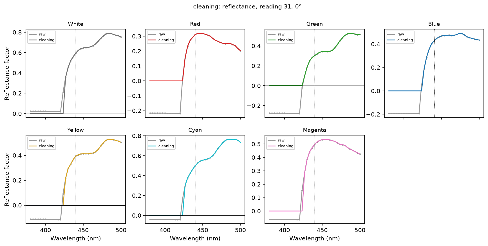

*Figure 4. Reflectance after cleaning, reading 31, 0°. Produced by `scripts/5_evaluate_method.py --method cleaning`.*

#### Reflectance × CMF

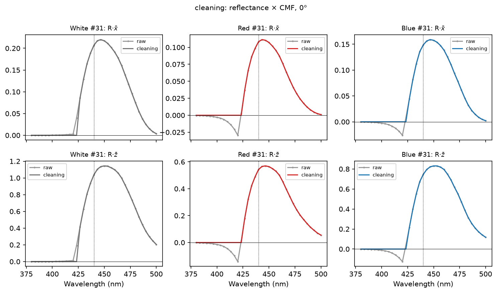

*Figure 5. $R\bar{x}$ and $R\bar{z}$ for White, Red and Blue at reading 31, 0°: raw data and cleaning. The area under these curves is what ends up in X and Z. Produced by `scripts/5_evaluate_method.py --method cleaning`.*

#### Reading 31

*Table 5. Cleaning, reading 31, 0°. Produced by `scripts/5_evaluate_method.py --method cleaning`.*

| Ramp | X | Y | Z | ΔX | ΔY | ΔZ | Δxy | ΔE |
|---|---:|---:|---:|---:|---:|---:|---:|---:|
| White | 0.5705 | 0.6212 | 0.5045 | -0.0009 | 0.0000 | -0.0044 | 0.0012 | 0.53 |
| Red | 0.3725 | 0.3115 | 0.2138 | +0.0016 | 0.0000 | +0.0077 | 0.0044 | 1.13 |
| Green | 0.3471 | 0.4331 | 0.2832 | +0.0022 | +0.0001 | +0.0105 | 0.0052 | 1.18 |
| Blue | 0.2316 | 0.2722 | 0.3402 | +0.0013 | 0.0000 | +0.0063 | 0.0030 | 0.96 |
| Yellow | 0.5158 | 0.5298 | 0.3267 | +0.0005 | 0.0000 | +0.0026 | 0.0010 | 0.29 |
| Cyan | 0.3911 | 0.5020 | 0.4536 | -0.0003 | 0.0000 | -0.0013 | 0.0005 | 0.14 |
| Magenta | 0.4082 | 0.3832 | 0.3774 | -0.0001 | 0.0000 | -0.0003 | 0.0001 | 0.04 |

*Table 6. Cleaning, reading 31, 90°. Produced by `scripts/5_evaluate_method.py --method cleaning`.*

| Ramp | X | Y | Z | ΔX | ΔY | ΔZ | Δxy | ΔE |
|---|---:|---:|---:|---:|---:|---:|---:|---:|
| White | 0.9173 | 1.0059 | 0.7982 | -0.0029 | -0.0001 | -0.0139 | 0.0025 | 1.10 |
| Red | 0.5272 | 0.4197 | 0.2810 | +0.0001 | 0.0000 | +0.0006 | 0.0003 | 0.07 |
| Green | 0.4789 | 0.6130 | 0.3812 | +0.0007 | 0.0000 | +0.0032 | 0.0011 | 0.26 |
| Blue | 0.3031 | 0.3673 | 0.5001 | -0.0015 | 0.0000 | -0.0072 | 0.0024 | 0.75 |
| Yellow | 0.8195 | 0.8403 | 0.4818 | -0.0006 | 0.0000 | -0.0027 | 0.0007 | 0.21 |
| Cyan | 0.5785 | 0.7799 | 0.6968 | -0.0021 | -0.0001 | -0.0101 | 0.0023 | 0.69 |
| Magenta | 0.6276 | 0.5806 | 0.5985 | -0.0022 | -0.0001 | -0.0106 | 0.0025 | 0.81 |

*Table 7. Cleaning, reading 31, 180°. Produced by `scripts/5_evaluate_method.py --method cleaning`.*

| Ramp | X | Y | Z | ΔX | ΔY | ΔZ | Δxy | ΔE |
|---|---:|---:|---:|---:|---:|---:|---:|---:|
| White | 0.5591 | 0.6056 | 0.4942 | -0.0005 | 0.0000 | -0.0024 | 0.0007 | 0.31 |
| Red | 0.3237 | 0.2657 | 0.1802 | +0.0019 | +0.0001 | +0.0092 | 0.0062 | 1.51 |
| Green | 0.3183 | 0.3892 | 0.2561 | +0.0013 | 0.0000 | +0.0061 | 0.0033 | 0.75 |
| Blue | 0.2180 | 0.2490 | 0.3085 | +0.0014 | 0.0000 | +0.0065 | 0.0035 | 1.10 |
| Yellow | 0.4980 | 0.5096 | 0.3106 | +0.0009 | 0.0000 | +0.0042 | 0.0017 | 0.48 |
| Cyan | 0.3736 | 0.4813 | 0.4347 | -0.0003 | 0.0000 | -0.0014 | 0.0005 | 0.15 |
| Magenta | 0.4037 | 0.3739 | 0.3753 | -0.0007 | 0.0000 | -0.0032 | 0.0012 | 0.37 |

#### All readings

Cleaning: one table per ramp, readings 0–31 (produced by <code>scripts/5_evaluate_method.py --method cleaning</code>)

**White**

| Orientation | ΔX range | ΔY range | ΔZ range | Δxy mean ± sd | ΔE mean ± sd | ΔE max (reading) |
|---|---:|---:|---:|---:|---:|---:|
| 0° | -0.0010 … +0.0026 | 0.0000 … +0.0001 | -0.0050 … +0.0125 | 0.0026 ± 0.0031 | 0.91 ± 1.07 | 3.84 (#0) |
| 90° | -0.0029 … +0.0014 | -0.0001 … 0.0000 | -0.0139 … +0.0066 | 0.0017 ± 0.0010 | 0.70 ± 0.45 | 1.61 (#4) |
| 180° | -0.0007 … +0.0020 | 0.0000 … +0.0001 | -0.0032 … +0.0094 | 0.0039 ± 0.0026 | 1.29 ± 0.83 | 2.94 (#2) |

**Red**

| Orientation | ΔX range | ΔY range | ΔZ range | Δxy mean ± sd | ΔE mean ± sd | ΔE max (reading) |
|---|---:|---:|---:|---:|---:|---:|
| 0° | +0.0014 … +0.0032 | 0.0000 … +0.0001 | +0.0065 … +0.0151 | 0.0079 ± 0.0027 | 2.20 ± 0.96 | 5.06 (#0) |
| 90° | -0.0003 … +0.0020 | 0.0000 … +0.0001 | -0.0012 … +0.0096 | 0.0024 ± 0.0025 | 0.79 ± 0.95 | 3.09 (#1) |
| 180° | +0.0012 … +0.0027 | 0.0000 … +0.0001 | +0.0057 … +0.0131 | 0.0089 ± 0.0016 | 2.35 ± 0.43 | 3.51 (#0) |

**Green**

| Orientation | ΔX range | ΔY range | ΔZ range | Δxy mean ± sd | ΔE mean ± sd | ΔE max (reading) |
|---|---:|---:|---:|---:|---:|---:|
| 0° | +0.0016 … +0.0035 | 0.0000 … +0.0001 | +0.0076 … +0.0167 | 0.0078 ± 0.0027 | 1.99 ± 0.92 | 4.09 (#0) |
| 90° | +0.0002 … +0.0019 | 0.0000 … +0.0001 | +0.0010 … +0.0090 | 0.0029 ± 0.0021 | 0.89 ± 0.91 | 3.23 (#3) |
| 180° | +0.0013 … +0.0031 | 0.0000 … +0.0001 | +0.0061 … +0.0149 | 0.0092 ± 0.0034 | 2.32 ± 1.00 | 4.77 (#2) |

**Blue**

| Orientation | ΔX range | ΔY range | ΔZ range | Δxy mean ± sd | ΔE mean ± sd | ΔE max (reading) |
|---|---:|---:|---:|---:|---:|---:|
| 0° | +0.0008 … +0.0035 | 0.0000 … +0.0001 | +0.0037 … +0.0167 | 0.0058 ± 0.0040 | 2.15 ± 1.67 | 5.83 (#4) |
| 90° | -0.0017 … +0.0016 | -0.0001 … 0.0000 | -0.0083 … +0.0078 | 0.0023 ± 0.0016 | 0.85 ± 0.64 | 2.43 (#4) |
| 180° | +0.0007 … +0.0031 | 0.0000 … +0.0001 | +0.0035 … +0.0147 | 0.0068 ± 0.0036 | 2.35 ± 1.19 | 4.68 (#3) |

**Yellow**

| Orientation | ΔX range | ΔY range | ΔZ range | Δxy mean ± sd | ΔE mean ± sd | ΔE max (reading) |
|---|---:|---:|---:|---:|---:|---:|
| 0° | +0.0005 … +0.0021 | 0.0000 … +0.0001 | +0.0026 … +0.0101 | 0.0035 ± 0.0022 | 1.04 ± 0.78 | 3.59 (#0) |
| 90° | -0.0007 … +0.0010 | 0.0000 … 0.0000 | -0.0035 … +0.0047 | 0.0010 ± 0.0009 | 0.33 ± 0.34 | 1.11 (#4) |
| 180° | +0.0009 … +0.0028 | 0.0000 … +0.0001 | +0.0042 … +0.0132 | 0.0062 ± 0.0024 | 1.69 ± 0.66 | 3.97 (#0) |

**Cyan**

| Orientation | ΔX range | ΔY range | ΔZ range | Δxy mean ± sd | ΔE mean ± sd | ΔE max (reading) |
|---|---:|---:|---:|---:|---:|---:|
| 0° | -0.0005 … +0.0022 | 0.0000 … +0.0001 | -0.0025 … +0.0104 | 0.0034 ± 0.0028 | 1.14 ± 1.06 | 3.46 (#1) |
| 90° | -0.0022 … +0.0017 | -0.0001 … 0.0000 | -0.0108 … +0.0080 | 0.0022 ± 0.0016 | 0.77 ± 0.68 | 2.62 (#2) |
| 180° | -0.0003 … +0.0024 | 0.0000 … +0.0001 | -0.0014 … +0.0113 | 0.0058 ± 0.0029 | 1.73 ± 0.85 | 3.01 (#1) |

**Magenta**

| Orientation | ΔX range | ΔY range | ΔZ range | Δxy mean ± sd | ΔE mean ± sd | ΔE max (reading) |
|---|---:|---:|---:|---:|---:|---:|
| 0° | -0.0003 … +0.0014 | 0.0000 … 0.0000 | -0.0015 … +0.0068 | 0.0020 ± 0.0017 | 0.75 ± 0.70 | 2.39 (#1) |
| 90° | -0.0022 … +0.0011 | -0.0001 … 0.0000 | -0.0107 … +0.0054 | 0.0018 ± 0.0009 | 0.59 ± 0.33 | 1.43 (#3) |
| 180° | -0.0007 … +0.0025 | 0.0000 … +0.0001 | -0.0032 … +0.0119 | 0.0062 ± 0.0033 | 2.01 ± 1.07 | 3.30 (#8) |

#### Swatches

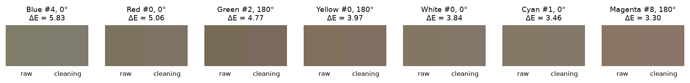

*Figure 6. For each ramp, the reading with the largest ΔE: raw data (left) and cleaning (right). Produced by `scripts/5_evaluate_method.py --method cleaning`.*

#### Observations and verdict

*Table 8. Cleaning, reflectance implied below 440 nm, over all 672 spectra. Produced by `scripts/5_evaluate_method.py --method cleaning`.*

| From | Max | Spectra above 1 |
|---|---:|---:|
| R·x̄ | 0.85 | 0 / 672 |
| R·z̄ | 0.85 | 0 / 672 |

- **Small effect overall.** Mean ΔE is 1.37 and the maximum is 5.83 (Blue #4, 0°). At reading 31 the ΔE stays at or below 1.51. Across all readings, 60 % of the spectra change by more than the historical repeatability reference after cleaning of 0.82. This is a comparison of magnitudes, not a significance test.
- **Y does not move.** ΔY never exceeds 0.0001.
- **Z mostly rises.** Removing a negative baseline adds back what the baseline was subtracting. Removing positive values through 423.333 nm can lower Z instead, for example White #31 at 90°: ΔZ = −0.0139.
- **Dark readings change most.** The largest ΔE values are at readings 0 to 8. There the baseline is large compared to the real signal.
- **Verdict: necessary, not sufficient.** Cleaning zeros bands through 423.333 nm and removes negative values, but it keeps the 426.667–436.667 nm region, which section 4 shows to be contaminated.

## 4 The band from 420 to 440 nm

> **In short:** between 420 and 440 nm the signal is a blend of real reflectance and the baseline. The baseline's share drops below 5 % only from 440 nm. That is our cutoff.

Figure 3 shows a steep climb from the baseline at 420 nm to the real signal around 440 nm. The question is: which of these bands can we trust?

### 4.1 Baseline leak

**Idea.** The baseline changes from reading to reading in a way that has nothing to do with the screen. If a band follows those changes, part of the baseline has *leaked* into it.

**How the leak is measured,** for each band, ramp and orientation:

1. Remove the real brightness trend. Within one ramp, regress the band on the mean of a trusted reference region (446–461 nm) and keep the residuals. Do the same for the baseline.
2. Regress the band residuals on the baseline residuals. The slope is the **leak**: the fraction of the baseline jitter that shows up in the band. 100 % means the band is the baseline; 0 % means the band ignores it.
3. Also record the correlation between the two residuals.

*Table 9. Baseline leak per band. Leak is the mean over the 7 ramps. Correlation is shown as mean (min) over the 7 ramps. The last column counts negative values over all 672 spectra. Produced by `scripts/4_band_420_440.py`.*

| Band (nm) | Leak 0° | Leak 90° | Leak 180° | Corr 0° | Corr 90° | Corr 180° | Negatives / 672 |
|---|---:|---:|---:|---:|---:|---:|---:|
| 420.0 | 100.5 % | 100.5 % | 100.5 % | 1.00 (1.00) | 1.00 (1.00) | 1.00 (1.00) | 615 |
| 423.3 | 37.8 % | 43.2 % | 34.8 % | 0.77 (0.58) | 0.70 (0.53) | 0.81 (0.64) | 247 |
| 426.7 | 13.6 % | 19.3 % | 16.6 % | 0.44 (0.23) | 0.45 (0.26) | 0.49 (-0.07) | 0 |
| 430.0 | 7.9 % | 11.6 % | 13.5 % | 0.46 (0.11) | 0.36 (0.22) | 0.52 (0.05) | 0 |
| 433.3 | 4.1 % | 7.3 % | 7.4 % | 0.39 (-0.16) | 0.26 (0.02) | 0.46 (-0.08) | 0 |
| 436.7 | 2.1 % | 7.0 % | 5.8 % | 0.34 (-0.32) | 0.27 (-0.14) | 0.52 (-0.05) | 0 |
| 440.0 | 0.0 % | 3.5 % | 2.4 % | 0.14 (-0.35) | 0.23 (-0.44) | 0.36 (-0.60) | 0 |
| 443.3 | 0.2 % | 2.3 % | 1.8 % | 0.04 (-0.35) | 0.18 (-0.55) | 0.26 (-0.72) | 0 |
| 446.7 | 0.4 % | 2.2 % | 0.9 % | 0.08 (-0.33) | 0.26 (-0.07) | 0.12 (-0.53) | 0 |
| 450.0 | 0.3 % | 0.7 % | 0.4 % | 0.07 (-0.34) | 0.12 (-0.17) | 0.03 (-0.55) | 0 |

Observations:

- **420 nm is the baseline** (leak 100 %, correlation 1.00).
- **The leak fades over about 15 nm.** 423.3 nm still carries 35–43 % of the baseline jitter and has 247 negative values. By 430 nm the leak is down to 8–14 %, and by 436.7 nm to 2–7 %.
- **From 440 nm the leak is at the level of the reference region.** 446.7 nm overlaps the reference region, so it cannot be contaminated, yet it still shows a leak of up to 2.2 %. That is the background level of this estimate. 440 nm (at most 3.5 %) is in the same range.

### 4.2 Shape of the drop

If the climb from 420 to 440 nm were the real reflectance of the screen, each colour would climb in its own way. Figure 7 divides each spectrum by its value at 450 nm, so only the shape is left.

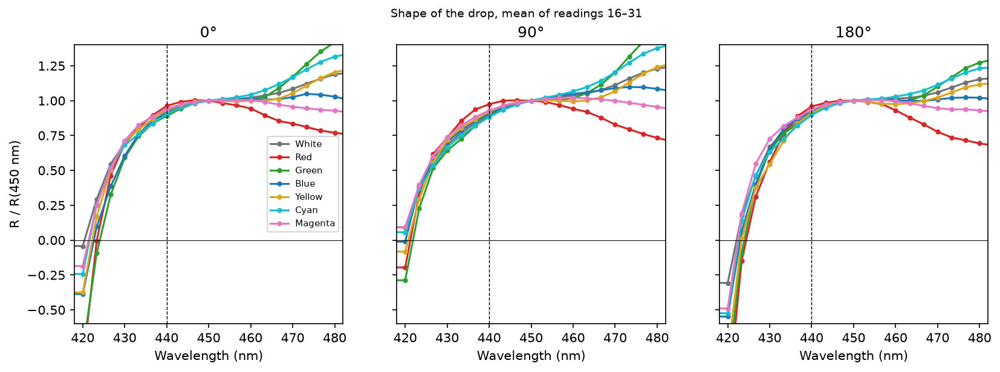

*Figure 7. Reflectance divided by reflectance at 450 nm, mean of readings 16–31, one line per ramp and one panel per orientation. Produced by `scripts/4_band_420_440.py`.*

- **Below about 437 nm, all seven ramps collapse onto the same curve.** The shape of the drop does not depend on the colour of the patch.
- **Above 440 nm, the curves separate by colour,** as real reflectance should.

A common shape points to something that affects every colour equally. That is either the instrument itself, such as the edge of its usable range smeared by its optical bandwidth, or a layer common to the whole screen, such as the polarizer or the screen protector. The data cannot tell these apart (see [section 8](#8-limitations-and-open-questions)). Either way, the bands below 437 nm do not tell us anything about the colour of each patch.

### 4.3 Reliability zones

Each band is assigned a zone from its worst leak over the three orientations:

| Zone | Rule |
|---|---|
| baseline | Part of the flat line (≤ 420 nm) |
| invalid | Negative values, or leak ≥ 25 % |
| contaminated | Leak ≥ 10 % |
| grey | Leak ≥ 5 % |
| reliable | Leak < 5 % |

The 5 % threshold sits just above the background level of the estimate (2.2 % at 446.7 nm, section 4.1).

*Table 10. Zone of each band. Produced by `scripts/4_band_420_440.py`.*

| Band (nm) | Max leak | Negatives | Zone |
|---|---:|---:|---:|
| 420.0 | 100.5 % | 615 | baseline |
| 423.3 | 43.2 % | 247 | invalid |
| 426.7 | 19.3 % | 0 | contaminated |
| 430.0 | 13.5 % | 0 | contaminated |
| 433.3 | 7.4 % | 0 | grey |
| 436.7 | 7.0 % | 0 | grey |
| 440.0 | 3.5 % | 0 | reliable |
| 443.3 | 2.3 % | 0 | reliable |
| 446.7 | 2.2 % | 0 | reliable |
| 450.0 | 0.7 % | 0 | reliable |

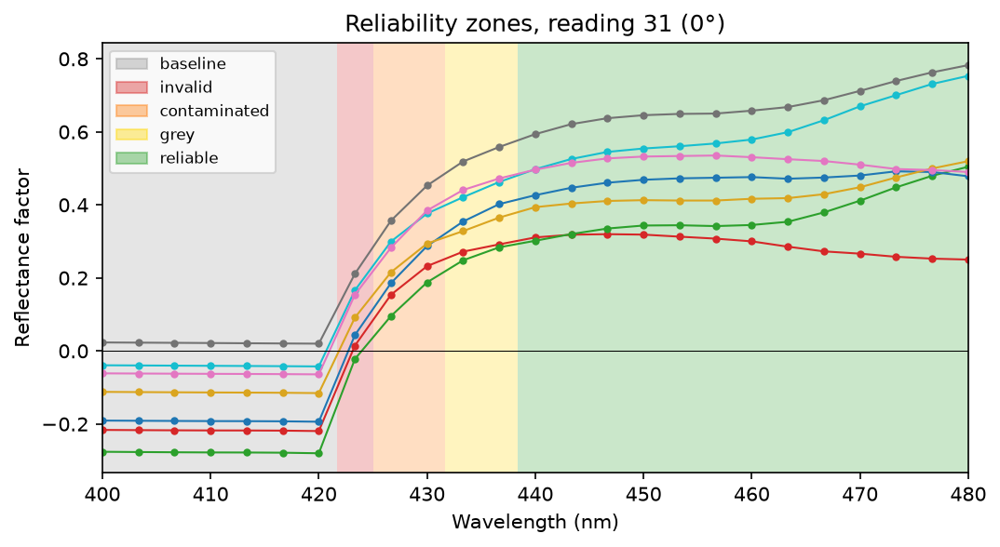

*Figure 8. Reliability zones over the raw spectra at reading 31, 0°. Produced by `scripts/4_band_420_440.py`.*

### 4.4 Choosing the cutoff

The **cutoff** is the first band we keep. Everything below it is replaced in section 5. Choosing it is a trade-off:

- a lower cutoff keeps more measured data but lets more baseline in;
- a higher cutoff is cleaner but leaves more to reconstruct.

*Table 11. Cutoff candidates. "Worst leak ≥ cutoff" is the highest leak among the bands from the cutoff up to 450 nm. "X below" and "Z below" are the shares of X and Z of a perfect reflector under D50 that lie below the cutoff and must be reconstructed. Produced by `scripts/4_band_420_440.py`.*

| Cutoff (nm) | Zone | Worst leak ≥ cutoff | Negatives ≥ cutoff | X below | Z below |
|---|---:|---:|---:|---:|---:|
| 430.0 | contaminated | 13.5 % | 0 | 1.6 % | 9.1 % |
| 433.3 | grey | 7.4 % | 0 | 2.2 % | 12.2 % |
| 436.7 | grey | 7.0 % | 0 | 2.8 % | 16.0 % |
| 440.0 | reliable | 3.5 % | 0 | 3.6 % | 20.4 % |
| 443.3 | reliable | 2.3 % | 0 | 4.4 % | 25.5 % |

**Decision: cutoff at 440 nm,** the lowest band in the reliable zone. Going lower would keep bands that still carry 7 % or more of the baseline. Going higher would add 5 percentage points of Z to reconstruct without making the data noticeably cleaner.

The price is that 20.4 % of Z and 3.6 % of X of a perfect reflector must be reconstructed.

## 5 Reconstructing the region below the cutoff

> **In short:** we tried three ways to fill the gap below 440 nm. Assuming zero reflectance is too low, and a Gaussian fit produces impossible reflectance. Holding the 440 nm value constant is the most plausible choice.

All three methods share the same steps:

1. Clean the spectrum (section 3.2).
2. Keep every band from 440 nm upward unchanged.
3. Replace the bands below 440 nm with an estimate.

They differ only in step 3. To check whether the estimate is physically possible, we compute the **implied reflectance**: the reflectance that the method effectively assumes below 440 nm. A passive screen without fluorescence cannot reflect more light than it receives, so an implied reflectance above 1 is impossible.

### 5.1 Truncation

#### Idea

Assume the screen reflects nothing below 440 nm.

#### Technical details

- $R(\lambda) = 0$ for $\lambda < 440$ nm.
- The method adds nothing to X, Y and Z below the cutoff.

#### Assumptions and limits

- The method assumes that the reflectance falls from its 440 nm value (0.3–0.6 at reading 31, Figure 3) to zero in one step. No real material behaves like that.
- It is a **lower bound**: the true contribution of the region cannot be smaller than zero.

#### Spectrum

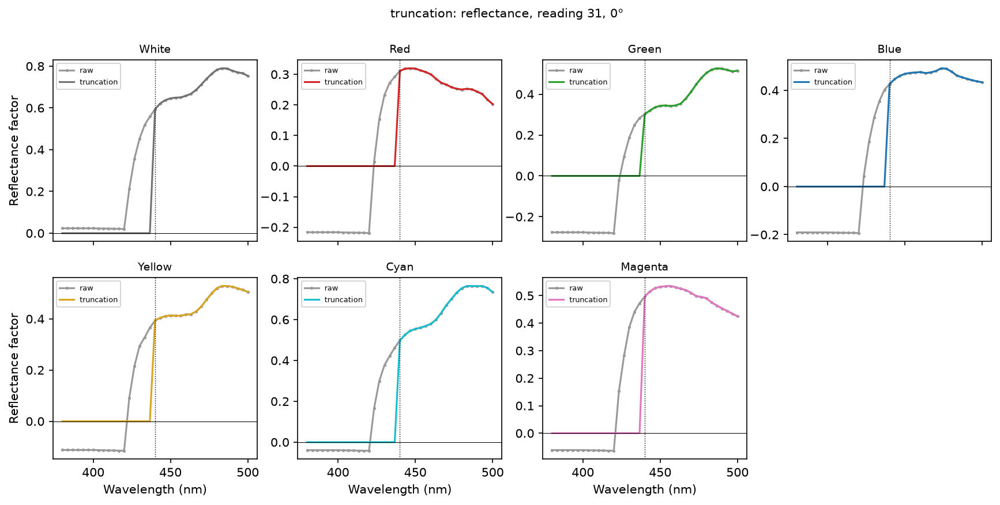

*Figure 9. Reflectance implied by truncation, reading 31, 0°. Produced by `scripts/5_evaluate_method.py --method truncation`.*

#### Reflectance × CMF

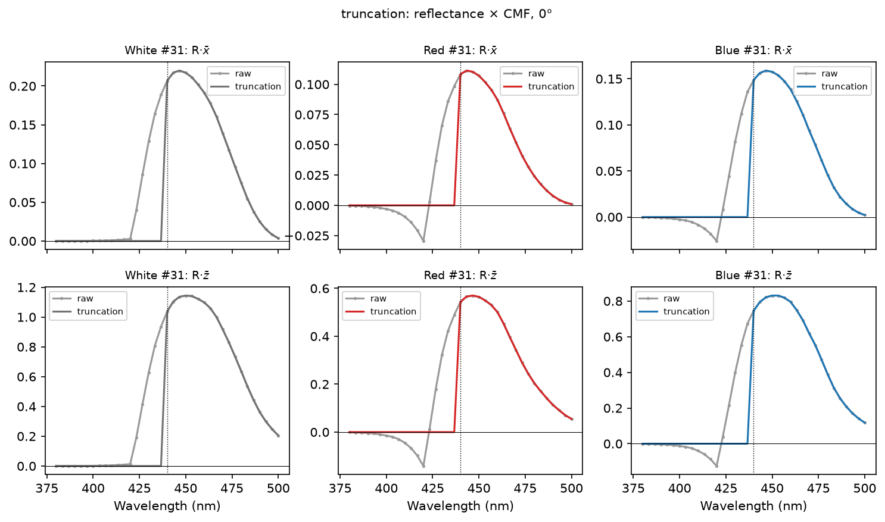

*Figure 10. $R\bar{x}$ and $R\bar{z}$ for White, Red and Blue at reading 31, 0°: raw data and truncation. Produced by `scripts/5_evaluate_method.py --method truncation`.*

#### Reading 31

*Table 12. Truncation, reading 31, 0°. Produced by `scripts/5_evaluate_method.py --method truncation`.*

| Ramp | X | Y | Z | ΔX | ΔY | ΔZ | Δxy | ΔE |
|---|---:|---:|---:|---:|---:|---:|---:|---:|
| White | 0.5591 | 0.6206 | 0.4485 | -0.0123 | -0.0006 | -0.0604 | 0.0178 | 6.38 |
| Red | 0.3667 | 0.3113 | 0.1853 | -0.0042 | -0.0002 | -0.0208 | 0.0124 | 3.10 |
| Green | 0.3420 | 0.4328 | 0.2582 | -0.0029 | -0.0002 | -0.0146 | 0.0074 | 1.60 |
| Blue | 0.2240 | 0.2718 | 0.3030 | -0.0063 | -0.0003 | -0.0310 | 0.0157 | 4.90 |
| Yellow | 0.5085 | 0.5294 | 0.2908 | -0.0067 | -0.0003 | -0.0333 | 0.0131 | 3.61 |
| Cyan | 0.3817 | 0.5016 | 0.4073 | -0.0097 | -0.0005 | -0.0476 | 0.0172 | 4.90 |
| Magenta | 0.3986 | 0.3828 | 0.3303 | -0.0096 | -0.0005 | -0.0474 | 0.0190 | 6.48 |

*Table 13. Truncation, reading 31, 90°. Produced by `scripts/5_evaluate_method.py --method truncation`.*

| Ramp | X | Y | Z | ΔX | ΔY | ΔZ | Δxy | ΔE |
|---|---:|---:|---:|---:|---:|---:|---:|---:|
| White | 0.8999 | 1.0050 | 0.7125 | -0.0203 | -0.0009 | -0.0997 | 0.0183 | 6.96 |
| Red | 0.5192 | 0.4193 | 0.2415 | -0.0079 | -0.0004 | -0.0389 | 0.0170 | 4.34 |
| Green | 0.4718 | 0.6127 | 0.3464 | -0.0064 | -0.0003 | -0.0317 | 0.0118 | 2.58 |
| Blue | 0.2913 | 0.3668 | 0.4420 | -0.0133 | -0.0006 | -0.0652 | 0.0228 | 7.10 |
| Yellow | 0.8088 | 0.8398 | 0.4291 | -0.0113 | -0.0005 | -0.0554 | 0.0142 | 4.14 |
| Cyan | 0.5643 | 0.7793 | 0.6273 | -0.0162 | -0.0007 | -0.0796 | 0.0189 | 5.39 |
| Magenta | 0.6123 | 0.5798 | 0.5233 | -0.0175 | -0.0008 | -0.0857 | 0.0217 | 7.50 |

*Table 14. Truncation, reading 31, 180°. Produced by `scripts/5_evaluate_method.py --method truncation`.*

| Ramp | X | Y | Z | ΔX | ΔY | ΔZ | Δxy | ΔE |
|---|---:|---:|---:|---:|---:|---:|---:|---:|
| White | 0.5478 | 0.6051 | 0.4389 | -0.0117 | -0.0006 | -0.0577 | 0.0174 | 6.27 |
| Red | 0.3188 | 0.2655 | 0.1559 | -0.0030 | -0.0002 | -0.0151 | 0.0106 | 2.51 |
| Green | 0.3133 | 0.3889 | 0.2313 | -0.0038 | -0.0002 | -0.0187 | 0.0104 | 2.25 |
| Blue | 0.2106 | 0.2486 | 0.2724 | -0.0060 | -0.0003 | -0.0296 | 0.0165 | 5.23 |
| Yellow | 0.4912 | 0.5093 | 0.2771 | -0.0059 | -0.0003 | -0.0293 | 0.0121 | 3.28 |
| Cyan | 0.3644 | 0.4808 | 0.3894 | -0.0095 | -0.0004 | -0.0467 | 0.0177 | 4.95 |
| Magenta | 0.3938 | 0.3735 | 0.3267 | -0.0105 | -0.0005 | -0.0517 | 0.0209 | 6.78 |

#### All readings

Truncation: one table per ramp, readings 0–31 (produced by <code>scripts/5_evaluate_method.py --method truncation</code>)

**White**

| Orientation | ΔX range | ΔY range | ΔZ range | Δxy mean ± sd | ΔE mean ± sd | ΔE max (reading) |
|---|---:|---:|---:|---:|---:|---:|
| 0° | -0.0125 … -0.0009 | -0.0006 … -0.0001 | -0.0613 … -0.0047 | 0.0144 ± 0.0038 | 4.58 ± 1.46 | 6.44 (#30) |
| 90° | -0.0203 … -0.0036 | -0.0009 … -0.0002 | -0.0997 … -0.0178 | 0.0164 ± 0.0015 | 5.70 ± 0.86 | 6.98 (#29) |
| 180° | -0.0117 … -0.0015 | -0.0006 … -0.0001 | -0.0577 … -0.0078 | 0.0123 ± 0.0026 | 3.65 ± 1.11 | 6.32 (#30) |

**Red**

| Orientation | ΔX range | ΔY range | ΔZ range | Δxy mean ± sd | ΔE mean ± sd | ΔE max (reading) |
|---|---:|---:|---:|---:|---:|---:|
| 0° | -0.0044 … -0.0001 | -0.0002 … -0.0001 | -0.0219 … -0.0008 | 0.0085 ± 0.0028 | 2.15 ± 0.70 | 3.26 (#29) |
| 90° | -0.0084 … -0.0024 | -0.0004 … -0.0002 | -0.0413 … -0.0119 | 0.0155 ± 0.0026 | 4.24 ± 0.40 | 4.76 (#22) |
| 180° | -0.0031 … -0.0007 | -0.0002 … -0.0001 | -0.0154 … -0.0037 | 0.0070 ± 0.0022 | 1.68 ± 0.57 | 2.88 (#2) |

**Green**

| Orientation | ΔX range | ΔY range | ΔZ range | Δxy mean ± sd | ΔE mean ± sd | ΔE max (reading) |
|---|---:|---:|---:|---:|---:|---:|
| 0° | -0.0035 … -0.0005 | -0.0002 … -0.0001 | -0.0177 … -0.0028 | 0.0062 ± 0.0023 | 1.38 ± 0.50 | 2.03 (#22) |
| 90° | -0.0069 … -0.0028 | -0.0003 … -0.0002 | -0.0338 … -0.0140 | 0.0121 ± 0.0007 | 2.91 ± 0.52 | 4.83 (#0) |
| 180° | -0.0038 … +0.0003 | -0.0002 … 0.0000 | -0.0187 … +0.0013 | 0.0061 ± 0.0025 | 1.36 ± 0.53 | 2.25 (#31) |

**Blue**

| Orientation | ΔX range | ΔY range | ΔZ range | Δxy mean ± sd | ΔE mean ± sd | ΔE max (reading) |
|---|---:|---:|---:|---:|---:|---:|
| 0° | -0.0068 … -0.0003 | -0.0003 … -0.0001 | -0.0335 … -0.0018 | 0.0118 ± 0.0051 | 3.87 ± 1.65 | 5.39 (#16) |
| 90° | -0.0137 … -0.0032 | -0.0006 … -0.0002 | -0.0674 … -0.0160 | 0.0185 ± 0.0032 | 6.33 ± 0.52 | 7.31 (#26) |
| 180° | -0.0063 … -0.0003 | -0.0003 … -0.0001 | -0.0311 … -0.0019 | 0.0112 ± 0.0043 | 4.02 ± 1.70 | 5.65 (#30) |

**Yellow**

| Orientation | ΔX range | ΔY range | ΔZ range | Δxy mean ± sd | ΔE mean ± sd | ΔE max (reading) |
|---|---:|---:|---:|---:|---:|---:|
| 0° | -0.0067 … -0.0015 | -0.0003 … -0.0001 | -0.0333 … -0.0075 | 0.0116 ± 0.0013 | 3.07 ± 0.37 | 3.61 (#31) |
| 90° | -0.0114 … -0.0043 | -0.0005 … -0.0002 | -0.0558 … -0.0213 | 0.0148 ± 0.0009 | 4.35 ± 0.79 | 6.68 (#0) |
| 180° | -0.0059 … -0.0003 | -0.0003 … -0.0001 | -0.0293 … -0.0019 | 0.0078 ± 0.0025 | 1.98 ± 0.69 | 3.28 (#31) |

**Cyan**

| Orientation | ΔX range | ΔY range | ΔZ range | Δxy mean ± sd | ΔE mean ± sd | ΔE max (reading) |
|---|---:|---:|---:|---:|---:|---:|
| 0° | -0.0101 … -0.0016 | -0.0005 … -0.0001 | -0.0494 … -0.0084 | 0.0134 ± 0.0031 | 3.77 ± 0.89 | 5.07 (#30) |
| 90° | -0.0165 … -0.0030 | -0.0007 … -0.0002 | -0.0809 … -0.0150 | 0.0162 ± 0.0022 | 4.81 ± 0.46 | 5.61 (#1) |
| 180° | -0.0095 … -0.0011 | -0.0004 … -0.0001 | -0.0467 … -0.0056 | 0.0103 ± 0.0033 | 2.79 ± 0.99 | 4.95 (#30) |

**Magenta**

| Orientation | ΔX range | ΔY range | ΔZ range | Δxy mean ± sd | ΔE mean ± sd | ΔE max (reading) |
|---|---:|---:|---:|---:|---:|---:|
| 0° | -0.0101 … -0.0025 | -0.0005 … -0.0001 | -0.0496 … -0.0125 | 0.0160 ± 0.0025 | 5.51 ± 0.90 | 6.70 (#29) |
| 90° | -0.0176 … -0.0040 | -0.0008 … -0.0002 | -0.0864 … -0.0199 | 0.0192 ± 0.0021 | 7.03 ± 0.47 | 7.60 (#28) |
| 180° | -0.0105 … -0.0013 | -0.0005 … -0.0001 | -0.0517 … -0.0065 | 0.0115 ± 0.0048 | 3.60 ± 1.73 | 6.78 (#31) |

#### Swatches

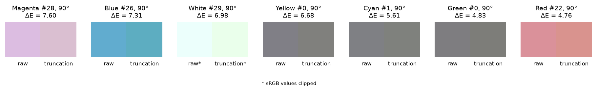

*Figure 11. For each ramp, the reading with the largest ΔE: raw data (left) and truncation (right). Produced by `scripts/5_evaluate_method.py --method truncation`.*

#### Observations and verdict

*Table 15. Truncation, reflectance implied below 440 nm, over all 672 spectra. Produced by `scripts/5_evaluate_method.py --method truncation`.*

| From | Max | Spectra above 1 |
|---|---:|---:|
| R·x̄ | 0.00 | 0 / 672 |
| R·z̄ | 0.00 | 0 / 672 |

- **Z always drops.** ΔZ is negative in almost every spectrum, down to −0.0997 (White #31, 90°). X drops about five times less, and Y barely moves.
- **Colours shift towards yellow.** Less Z means a higher x and y on the chromaticity diagram (see Figure 19).
- **The effect grows with brightness.** The largest ΔE values are mostly at the bright end of the ramps, where the removed signal is largest. Mean ΔE is 3.75 and the maximum is 7.60.
- **Verdict: a lower bound, not an estimate.** Truncation is useful as the lowest possible answer, but its assumption contradicts the data at 440 nm.

### 5.2 Gaussian extrapolation

#### Idea

Just above the cutoff, $R\bar{x}$ and $R\bar{z}$ look like the right half of a bell curve (Figure 13). Fit a Gaussian to that half and use it to draw the missing left half.

#### Technical details

- **Model:** $g(\lambda) = A\,\exp\!\left(-\dfrac{(\lambda-\mu)^2}{2\sigma^2}\right)$.
- **Fit:** least squares (SciPy `curve_fit`) on the 13 bands from 440 to 480 nm.
- **Separate fits:** one for $R\bar{x}$ and one for $R\bar{z}$, for every spectrum.
- **Bounds:** $A \ge 0$, $\mu$ within 440 ± 60 nm, $\sigma$ between 5 and 100 nm.
- **Start:** $A$ at the maximum, $\mu$ at its position, $\sigma = 20$ nm.
- **Below 440 nm:** the contribution to X (or Z) of each band is $g(\lambda)\,k\,S(\lambda)$.
- **Y:** not reconstructed. $R\bar{y}$ below 440 nm stays at zero, as in truncation. It is only 0.1 % of Y (Table 1).
- **Implied reflectance:** $g(\lambda)/\bar{x}(\lambda)$ and $g(\lambda)/\bar{z}(\lambda)$.

#### Assumptions and limits

- **The method assumes the bell is symmetric.** The colour matching functions are not: their left side is steeper than their right side.
  - $\bar{x}$ lobe: peak at 442 nm, half height reached 19 nm to the left and 30 nm to the right.
  - $\bar{z}$: peak at 446 nm, half height reached 23 nm to the left and 32 nm to the right.

  A Gaussian fitted to the gentle right side falls too slowly on the left, so it overestimates the missing area.
- **The two fits are independent,** so they imply two different reflectances for the same surface at the same wavelength (Figure 12).
- Y is left truncated, which is slightly inconsistent with X and Z.

#### Spectrum

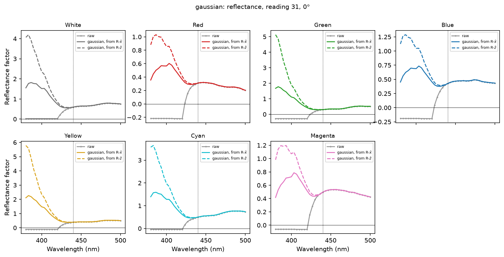

*Figure 12. Reflectance implied by the Gaussian fit to $R\bar{x}$ (solid) and to $R\bar{z}$ (dashed), reading 31, 0°. Produced by `scripts/5_evaluate_method.py --method gaussian`.*

#### Reflectance × CMF

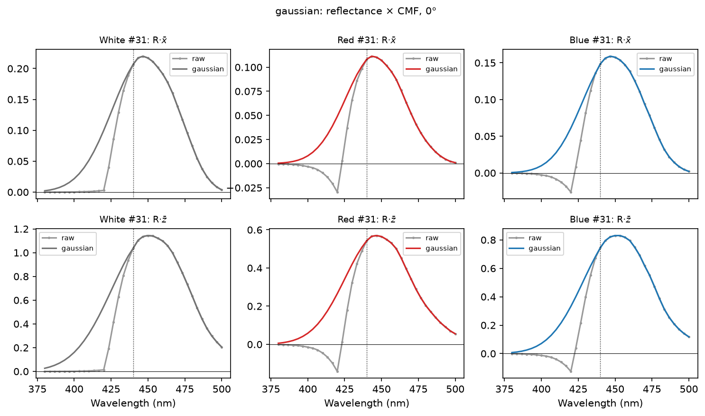

*Figure 13. $R\bar{x}$ and $R\bar{z}$ for White, Red and Blue at reading 31, 0°: raw data and Gaussian extrapolation. Produced by `scripts/5_evaluate_method.py --method gaussian`.*

#### Reading 31

*Table 16. Gaussian, reading 31, 0°. Produced by `scripts/5_evaluate_method.py --method gaussian`.*

| Ramp | X | Y | Z | ΔX | ΔY | ΔZ | Δxy | ΔE |
|---|---:|---:|---:|---:|---:|---:|---:|---:|
| White | 0.5822 | 0.6206 | 0.5747 | +0.0108 | -0.0006 | +0.0658 | 0.0180 | 9.03 |
| Red | 0.3781 | 0.3113 | 0.2465 | +0.0072 | -0.0002 | +0.0404 | 0.0224 | 5.65 |
| Green | 0.3551 | 0.4328 | 0.3335 | +0.0102 | -0.0002 | +0.0608 | 0.0287 | 7.11 |
| Blue | 0.2387 | 0.2718 | 0.3816 | +0.0084 | -0.0003 | +0.0476 | 0.0221 | 6.48 |
| Yellow | 0.5258 | 0.5294 | 0.3876 | +0.0105 | -0.0003 | +0.0635 | 0.0233 | 6.93 |
| Cyan | 0.4009 | 0.5016 | 0.5117 | +0.0095 | -0.0005 | +0.0568 | 0.0189 | 5.92 |
| Magenta | 0.4153 | 0.3828 | 0.4190 | +0.0071 | -0.0005 | +0.0413 | 0.0155 | 4.57 |

*Table 17. Gaussian, reading 31, 90°. Produced by `scripts/5_evaluate_method.py --method gaussian`.*

| Ramp | X | Y | Z | ΔX | ΔY | ΔZ | Δxy | ΔE |
|---|---:|---:|---:|---:|---:|---:|---:|---:|
| White | 0.9325 | 1.0050 | 0.8906 | +0.0123 | -0.0009 | +0.0785 | 0.0136 | 7.15 |
| Red | 0.5338 | 0.4193 | 0.3178 | +0.0067 | -0.0004 | +0.0374 | 0.0154 | 3.89 |
| Green | 0.4895 | 0.6127 | 0.4482 | +0.0113 | -0.0003 | +0.0701 | 0.0241 | 6.02 |
| Blue | 0.3111 | 0.3668 | 0.5466 | +0.0065 | -0.0006 | +0.0393 | 0.0127 | 3.69 |
| Yellow | 0.8323 | 0.8398 | 0.5624 | +0.0122 | -0.0005 | +0.0779 | 0.0187 | 5.78 |
| Cyan | 0.5909 | 0.7793 | 0.7722 | +0.0104 | -0.0007 | +0.0652 | 0.0144 | 4.44 |
| Magenta | 0.6382 | 0.5798 | 0.6592 | +0.0084 | -0.0008 | +0.0502 | 0.0120 | 3.56 |

*Table 18. Gaussian, reading 31, 180°. Produced by `scripts/5_evaluate_method.py --method gaussian`.*

| Ramp | X | Y | Z | ΔX | ΔY | ΔZ | Δxy | ΔE |
|---|---:|---:|---:|---:|---:|---:|---:|---:|
| White | 0.5708 | 0.6051 | 0.5644 | +0.0112 | -0.0006 | +0.0677 | 0.0189 | 9.59 |
| Red | 0.3285 | 0.2655 | 0.2072 | +0.0067 | -0.0002 | +0.0362 | 0.0237 | 5.67 |
| Green | 0.3253 | 0.3889 | 0.2997 | +0.0082 | -0.0002 | +0.0498 | 0.0258 | 6.45 |
| Blue | 0.2243 | 0.2486 | 0.3451 | +0.0077 | -0.0003 | +0.0430 | 0.0219 | 6.37 |
| Yellow | 0.5075 | 0.5093 | 0.3689 | +0.0104 | -0.0003 | +0.0624 | 0.0239 | 6.98 |
| Cyan | 0.3834 | 0.4808 | 0.4946 | +0.0095 | -0.0004 | +0.0585 | 0.0203 | 6.23 |
| Magenta | 0.4113 | 0.3735 | 0.4188 | +0.0070 | -0.0005 | +0.0403 | 0.0151 | 4.28 |

#### All readings

Gaussian: one table per ramp, readings 0–31 (produced by <code>scripts/5_evaluate_method.py --method gaussian</code>)

**White**

| Orientation | ΔX range | ΔY range | ΔZ range | Δxy mean ± sd | ΔE mean ± sd | ΔE max (reading) |
|---|---:|---:|---:|---:|---:|---:|
| 0° | +0.0059 … +0.0109 | -0.0006 … -0.0001 | +0.0331 … +0.0666 | 0.0206 ± 0.0040 | 9.18 ± 0.79 | 10.64 (#6) |
| 90° | +0.0057 … +0.0131 | -0.0009 … -0.0002 | +0.0322 … +0.0822 | 0.0170 ± 0.0034 | 7.50 ± 0.82 | 9.69 (#5) |
| 180° | +0.0050 … +0.0112 | -0.0006 … -0.0001 | +0.0272 … +0.0677 | 0.0224 ± 0.0027 | 9.05 ± 0.53 | 10.30 (#16) |

**Red**

| Orientation | ΔX range | ΔY range | ΔZ range | Δxy mean ± sd | ΔE mean ± sd | ΔE max (reading) |
|---|---:|---:|---:|---:|---:|---:|
| 0° | +0.0063 … +0.0077 | -0.0002 … -0.0001 | +0.0350 … +0.0416 | 0.0266 ± 0.0043 | 7.36 ± 1.98 | 12.49 (#0) |
| 90° | +0.0057 … +0.0071 | -0.0004 … -0.0002 | +0.0311 … +0.0386 | 0.0189 ± 0.0046 | 5.40 ± 1.92 | 9.83 (#1) |
| 180° | +0.0045 … +0.0067 | -0.0002 … -0.0001 | +0.0250 … +0.0362 | 0.0265 ± 0.0018 | 7.08 ± 0.98 | 9.81 (#0) |

**Green**

| Orientation | ΔX range | ΔY range | ΔZ range | Δxy mean ± sd | ΔE mean ± sd | ΔE max (reading) |
|---|---:|---:|---:|---:|---:|---:|
| 0° | +0.0069 … +0.0103 | -0.0002 … -0.0001 | +0.0400 … +0.0612 | 0.0311 ± 0.0033 | 8.63 ± 2.17 | 13.43 (#3) |
| 90° | +0.0063 … +0.0115 | -0.0003 … -0.0002 | +0.0353 … +0.0716 | 0.0250 ± 0.0017 | 7.15 ± 1.69 | 10.97 (#3) |
| 180° | +0.0054 … +0.0086 | -0.0002 … 0.0000 | +0.0298 … +0.0501 | 0.0306 ± 0.0026 | 8.83 ± 1.34 | 11.28 (#2) |

**Blue**

| Orientation | ΔX range | ΔY range | ΔZ range | Δxy mean ± sd | ΔE mean ± sd | ΔE max (reading) |
|---|---:|---:|---:|---:|---:|---:|
| 0° | +0.0065 … +0.0084 | -0.0003 … -0.0001 | +0.0369 … +0.0476 | 0.0247 ± 0.0044 | 8.10 ± 2.13 | 12.55 (#2) |
| 90° | +0.0058 … +0.0069 | -0.0006 … -0.0002 | +0.0334 … +0.0404 | 0.0179 ± 0.0052 | 5.64 ± 1.84 | 9.22 (#4) |
| 180° | +0.0053 … +0.0077 | -0.0003 … -0.0001 | +0.0297 … +0.0430 | 0.0265 ± 0.0045 | 8.27 ± 1.55 | 11.26 (#3) |

**Yellow**

| Orientation | ΔX range | ΔY range | ΔZ range | Δxy mean ± sd | ΔE mean ± sd | ΔE max (reading) |
|---|---:|---:|---:|---:|---:|---:|
| 0° | +0.0056 … +0.0106 | -0.0003 … -0.0001 | +0.0327 … +0.0642 | 0.0242 ± 0.0030 | 7.28 ± 1.41 | 10.99 (#0) |
| 90° | +0.0059 … +0.0126 | -0.0005 … -0.0002 | +0.0339 … +0.0812 | 0.0206 ± 0.0021 | 6.52 ± 1.14 | 9.21 (#4) |
| 180° | +0.0045 … +0.0104 | -0.0003 … -0.0001 | +0.0248 … +0.0624 | 0.0264 ± 0.0022 | 7.61 ± 0.64 | 10.15 (#0) |

**Cyan**

| Orientation | ΔX range | ΔY range | ΔZ range | Δxy mean ± sd | ΔE mean ± sd | ΔE max (reading) |
|---|---:|---:|---:|---:|---:|---:|
| 0° | +0.0061 … +0.0097 | -0.0005 … -0.0001 | +0.0353 … +0.0579 | 0.0227 ± 0.0038 | 7.53 ± 1.78 | 11.65 (#3) |
| 90° | +0.0064 … +0.0107 | -0.0007 … -0.0002 | +0.0368 … +0.0667 | 0.0186 ± 0.0042 | 6.10 ± 1.84 | 10.10 (#3) |
| 180° | +0.0050 … +0.0095 | -0.0004 … -0.0001 | +0.0272 … +0.0585 | 0.0252 ± 0.0031 | 8.31 ± 1.34 | 10.79 (#9) |

**Magenta**

| Orientation | ΔX range | ΔY range | ΔZ range | Δxy mean ± sd | ΔE mean ± sd | ΔE max (reading) |
|---|---:|---:|---:|---:|---:|---:|
| 0° | +0.0054 … +0.0077 | -0.0005 … -0.0001 | +0.0307 … +0.0438 | 0.0198 ± 0.0035 | 6.23 ± 1.42 | 9.24 (#1) |
| 90° | +0.0058 … +0.0085 | -0.0008 … -0.0002 | +0.0324 … +0.0504 | 0.0154 ± 0.0040 | 4.77 ± 1.35 | 7.58 (#3) |
| 180° | +0.0056 … +0.0071 | -0.0005 … -0.0001 | +0.0313 … +0.0403 | 0.0245 ± 0.0059 | 7.56 ± 1.97 | 9.89 (#8) |

#### Swatches

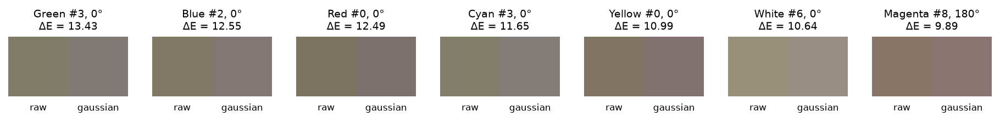

*Figure 14. For each ramp, the reading with the largest ΔE: raw data (left) and Gaussian extrapolation (right). Produced by `scripts/5_evaluate_method.py --method gaussian`.*

#### Observations and verdict

*Table 19. Gaussian, reflectance implied below 440 nm, over all 672 spectra. Produced by `scripts/5_evaluate_method.py --method gaussian`.*

| From | Max | Spectra above 1 |
|---|---:|---:|
| R·x̄ | 3.19 | 178 / 672 |
| R·z̄ | 9.30 | 445 / 672 |

- **The implied reflectance is impossible.** In two thirds of the spectra (445 of 672), the $\bar{z}$ fit implies that the screen reflects more light than it receives, up to 9.3 times. Figure 12 shows the White patch climbing above 4 near 380 nm.
- **The two fits disagree.** The $\bar{x}$ fit implies much less reflectance than the $\bar{z}$ fit (maximum 3.19 against 9.30).
- **Largest change of all methods.** Mean ΔE is 7.34 and the maximum is 13.43. Z rises in every spectrum, between +0.0248 and +0.0822.
- **Colours shift towards blue.** More Z means a lower x and y (see Figure 19).
- **Verdict: rejected.** The result in XYZ is not far from hold (section 6), but it is reached through impossible spectra. Without a physical constraint on the fit, the method cannot be trusted.

### 5.3 Hold

#### Idea

Assume the reflectance stays at its 440 nm value all the way down to 380 nm.

#### Technical details

- $R(\lambda) = R(440\ \text{nm})$ for $\lambda < 440$ nm.
- The same reflectance is used for X, Y and Z, so all three coordinates stay consistent.
- No free parameters and no fitting.

#### Assumptions and limits

- The method assumes no spectral feature below 440 nm: no peak and no dip.
- If the screen absorbs more strongly below 440 nm, for example in the polarizer, hold **overestimates** the region. Section 4.2 shows a common drop in all colours below 437 nm. If that drop is real and not an instrument artefact, the truth lies between truncation and hold.
- The implied reflectance can never exceed the measured value at 440 nm, so it can never be impossible.

#### Spectrum

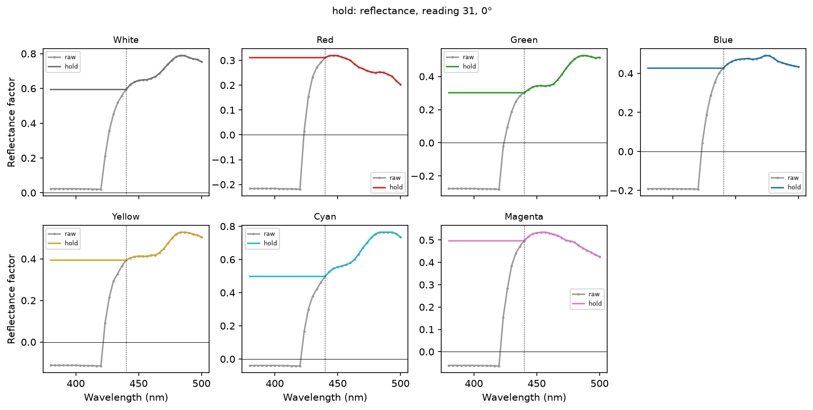

*Figure 15. Reflectance implied by hold, reading 31, 0°. Produced by `scripts/5_evaluate_method.py --method hold`.*

#### Reflectance × CMF

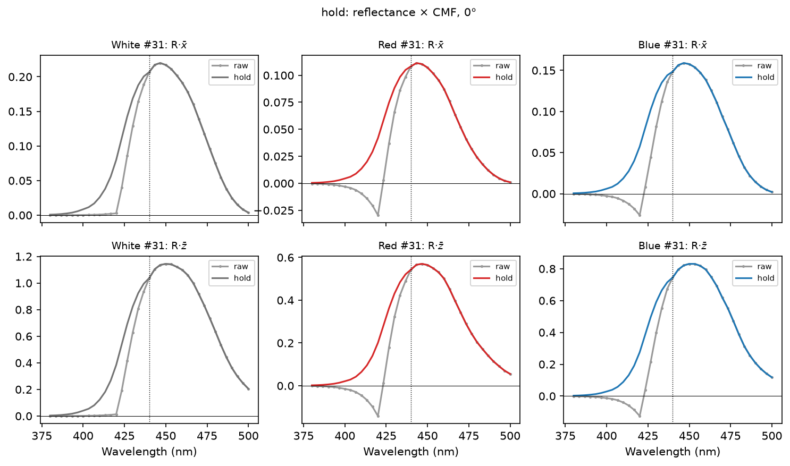

*Figure 16. $R\bar{x}$ and $R\bar{z}$ for White, Red and Blue at reading 31, 0°: raw data and hold. Produced by `scripts/5_evaluate_method.py --method hold`.*

#### Reading 31

*Table 20. Hold, reading 31, 0°. Produced by `scripts/5_evaluate_method.py --method hold`.*

| Ramp | X | Y | Z | ΔX | ΔY | ΔZ | Δxy | ΔE |
|---|---:|---:|---:|---:|---:|---:|---:|---:|
| White | 0.5797 | 0.6215 | 0.5485 | +0.0082 | +0.0003 | +0.0397 | 0.0109 | 5.49 |
| Red | 0.3775 | 0.3117 | 0.2377 | +0.0066 | +0.0002 | +0.0316 | 0.0175 | 4.49 |
| Green | 0.3524 | 0.4332 | 0.3090 | +0.0075 | +0.0002 | +0.0363 | 0.0176 | 4.15 |
| Blue | 0.2388 | 0.2724 | 0.3749 | +0.0085 | +0.0003 | +0.0409 | 0.0189 | 5.83 |
| Yellow | 0.5221 | 0.5300 | 0.3572 | +0.0069 | +0.0002 | +0.0331 | 0.0124 | 3.70 |
| Cyan | 0.3989 | 0.5023 | 0.4912 | +0.0075 | +0.0003 | +0.0363 | 0.0122 | 3.83 |
| Magenta | 0.4158 | 0.3835 | 0.4140 | +0.0075 | +0.0002 | +0.0363 | 0.0134 | 4.01 |

*Table 21. Hold, reading 31, 90°. Produced by `scripts/5_evaluate_method.py --method hold`.*

| Ramp | X | Y | Z | ΔX | ΔY | ΔZ | Δxy | ΔE |
|---|---:|---:|---:|---:|---:|---:|---:|---:|
| White | 0.9313 | 1.0063 | 0.8654 | +0.0110 | +0.0004 | +0.0533 | 0.0092 | 4.76 |
| Red | 0.5336 | 0.4199 | 0.3118 | +0.0065 | +0.0002 | +0.0314 | 0.0128 | 3.27 |
| Green | 0.4853 | 0.6132 | 0.4123 | +0.0071 | +0.0002 | +0.0343 | 0.0121 | 2.88 |
| Blue | 0.3121 | 0.3676 | 0.5432 | +0.0075 | +0.0002 | +0.0360 | 0.0114 | 3.53 |
| Yellow | 0.8280 | 0.8405 | 0.5224 | +0.0079 | +0.0003 | +0.0379 | 0.0092 | 2.91 |
| Cyan | 0.5899 | 0.7803 | 0.7521 | +0.0094 | +0.0003 | +0.0451 | 0.0100 | 3.11 |
| Magenta | 0.6391 | 0.5809 | 0.6540 | +0.0093 | +0.0003 | +0.0449 | 0.0105 | 3.16 |

*Table 22. Hold, reading 31, 180°. Produced by `scripts/5_evaluate_method.py --method hold`.*

| Ramp | X | Y | Z | ΔX | ΔY | ΔZ | Δxy | ΔE |
|---|---:|---:|---:|---:|---:|---:|---:|---:|
| White | 0.5681 | 0.6059 | 0.5378 | +0.0085 | +0.0003 | +0.0412 | 0.0116 | 5.99 |
| Red | 0.3284 | 0.2659 | 0.2028 | +0.0066 | +0.0002 | +0.0318 | 0.0207 | 5.01 |
| Green | 0.3230 | 0.3893 | 0.2784 | +0.0059 | +0.0002 | +0.0284 | 0.0151 | 3.59 |
| Blue | 0.2242 | 0.2492 | 0.3384 | +0.0076 | +0.0002 | +0.0364 | 0.0184 | 5.64 |
| Yellow | 0.5041 | 0.5098 | 0.3398 | +0.0069 | +0.0002 | +0.0334 | 0.0130 | 3.83 |
| Cyan | 0.3811 | 0.4815 | 0.4709 | +0.0072 | +0.0002 | +0.0348 | 0.0122 | 3.78 |
| Magenta | 0.4111 | 0.3742 | 0.4111 | +0.0068 | +0.0002 | +0.0326 | 0.0121 | 3.48 |

#### All readings

Hold: one table per ramp, readings 0–31 (produced by <code>scripts/5_evaluate_method.py --method hold</code>)

**White**

| Orientation | ΔX range | ΔY range | ΔZ range | Δxy mean ± sd | ΔE mean ± sd | ΔE max (reading) |
|---|---:|---:|---:|---:|---:|---:|
| 0° | +0.0054 … +0.0084 | +0.0002 … +0.0003 | +0.0260 … +0.0404 | 0.0147 ± 0.0045 | 6.51 ± 1.28 | 9.41 (#0) |
| 90° | +0.0050 … +0.0117 | +0.0002 … +0.0004 | +0.0239 … +0.0564 | 0.0124 ± 0.0029 | 5.45 ± 0.91 | 8.04 (#5) |
| 180° | +0.0048 … +0.0085 | +0.0002 … +0.0003 | +0.0231 … +0.0412 | 0.0171 ± 0.0032 | 6.93 ± 0.47 | 7.60 (#14) |

**Red**

| Orientation | ΔX range | ΔY range | ΔZ range | Δxy mean ± sd | ΔE mean ± sd | ΔE max (reading) |
|---|---:|---:|---:|---:|---:|---:|
| 0° | +0.0058 … +0.0074 | +0.0002 … +0.0002 | +0.0281 … +0.0358 | 0.0223 ± 0.0036 | 6.27 ± 1.70 | 10.94 (#0) |
| 90° | +0.0055 … +0.0065 | +0.0002 … +0.0002 | +0.0267 … +0.0314 | 0.0158 ± 0.0039 | 4.60 ± 1.70 | 8.41 (#1) |
| 180° | +0.0044 … +0.0068 | +0.0001 … +0.0002 | +0.0213 … +0.0329 | 0.0250 ± 0.0022 | 6.74 ± 0.82 | 8.62 (#0) |

**Green**

| Orientation | ΔX range | ΔY range | ΔZ range | Δxy mean ± sd | ΔE mean ± sd | ΔE max (reading) |
|---|---:|---:|---:|---:|---:|---:|
| 0° | +0.0057 … +0.0080 | +0.0002 … +0.0003 | +0.0273 … +0.0384 | 0.0210 ± 0.0038 | 5.71 ± 1.96 | 10.02 (#3) |
| 90° | +0.0057 … +0.0071 | +0.0002 … +0.0002 | +0.0276 … +0.0343 | 0.0153 ± 0.0036 | 4.42 ± 2.03 | 9.02 (#3) |
| 180° | +0.0053 … +0.0066 | +0.0002 … +0.0002 | +0.0254 … +0.0316 | 0.0232 ± 0.0050 | 6.53 ± 2.01 | 10.52 (#2) |

**Blue**

| Orientation | ΔX range | ΔY range | ΔZ range | Δxy mean ± sd | ΔE mean ± sd | ΔE max (reading) |
|---|---:|---:|---:|---:|---:|---:|
| 0° | +0.0066 … +0.0086 | +0.0002 … +0.0003 | +0.0317 … +0.0414 | 0.0215 ± 0.0042 | 7.34 ± 2.04 | 11.65 (#4) |
| 90° | +0.0053 … +0.0077 | +0.0002 … +0.0003 | +0.0256 … +0.0370 | 0.0150 ± 0.0029 | 5.01 ± 1.20 | 7.41 (#4) |
| 180° | +0.0049 … +0.0076 | +0.0002 … +0.0002 | +0.0237 … +0.0364 | 0.0215 ± 0.0035 | 7.04 ± 1.20 | 9.53 (#3) |

**Yellow**

| Orientation | ΔX range | ΔY range | ΔZ range | Δxy mean ± sd | ΔE mean ± sd | ΔE max (reading) |
|---|---:|---:|---:|---:|---:|---:|
| 0° | +0.0050 … +0.0070 | +0.0002 … +0.0002 | +0.0238 … +0.0337 | 0.0155 ± 0.0032 | 4.75 ± 1.37 | 8.54 (#0) |
| 90° | +0.0045 … +0.0080 | +0.0001 … +0.0003 | +0.0217 … +0.0388 | 0.0119 ± 0.0023 | 3.86 ± 1.04 | 6.50 (#4) |
| 180° | +0.0045 … +0.0075 | +0.0001 … +0.0002 | +0.0218 … +0.0359 | 0.0206 ± 0.0037 | 5.94 ± 1.15 | 9.22 (#0) |

**Cyan**

| Orientation | ΔX range | ΔY range | ΔZ range | Δxy mean ± sd | ΔE mean ± sd | ΔE max (reading) |
|---|---:|---:|---:|---:|---:|---:|
| 0° | +0.0054 … +0.0081 | +0.0002 … +0.0003 | +0.0261 … +0.0389 | 0.0165 ± 0.0035 | 5.59 ± 1.66 | 9.20 (#3) |
| 90° | +0.0054 … +0.0095 | +0.0002 … +0.0003 | +0.0261 … +0.0459 | 0.0135 ± 0.0032 | 4.53 ± 1.52 | 8.15 (#3) |
| 180° | +0.0047 … +0.0076 | +0.0002 … +0.0002 | +0.0228 … +0.0367 | 0.0202 ± 0.0039 | 6.70 ± 1.51 | 8.90 (#7) |

**Magenta**

| Orientation | ΔX range | ΔY range | ΔZ range | Δxy mean ± sd | ΔE mean ± sd | ΔE max (reading) |
|---|---:|---:|---:|---:|---:|---:|
| 0° | +0.0046 … +0.0076 | +0.0001 … +0.0002 | +0.0221 … +0.0367 | 0.0158 ± 0.0019 | 5.14 ± 0.96 | 7.29 (#1) |
| 90° | +0.0047 … +0.0094 | +0.0001 … +0.0003 | +0.0227 … +0.0454 | 0.0127 ± 0.0022 | 4.05 ± 0.82 | 5.95 (#3) |
| 180° | +0.0050 … +0.0068 | +0.0002 … +0.0002 | +0.0242 … +0.0326 | 0.0200 ± 0.0042 | 6.34 ± 1.50 | 8.02 (#8) |

#### Swatches

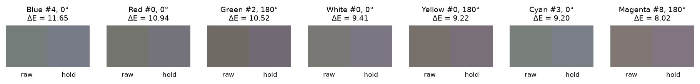

*Figure 17. For each ramp, the reading with the largest ΔE: raw data (left) and hold (right). Produced by `scripts/5_evaluate_method.py --method hold`.*

#### Observations and verdict

*Table 23. Hold, reflectance implied below 440 nm, over all 672 spectra. Produced by `scripts/5_evaluate_method.py --method hold`.*

| From | Max | Spectra above 1 |
|---|---:|---:|
| R·x̄ | 0.91 | 0 / 672 |
| R·z̄ | 0.91 | 0 / 672 |

- **Always physically possible.** The implied reflectance never exceeds 0.91, the highest value measured at 440 nm.
- **Z rises in every spectrum,** between +0.0213 and +0.0564. X rises about five times less and Y by at most 0.0004.
- **Colours shift towards blue,** like the Gaussian method but less (see Figure 19).
- **Dark readings change most in ΔE.** The largest values (up to 11.65, Blue #4, 0°) are mostly at readings 0–8. At those levels a fixed amount of added Z is a larger share of the colour.
- **Verdict: the most plausible estimate.** Hold is simple, consistent across X, Y and Z, and always physically possible. It is an upper bound if the screen absorbs more below 440 nm.

## 6 Comparison and choice

> **In short:** truncation and hold bracket the plausible answer, and the gap between them is the real uncertainty. Hold is the recommended method.

*Table 24. All methods compared with the raw data: 3 orientations × 7 ramps × 32 readings. "mean ΔE #31" is the mean over reading 31 only. Produced by `scripts/6_compare_methods.py`.*

| Method | mean ΔX | mean ΔY | mean ΔZ | mean Δxy | mean ΔE | p95 ΔE | max ΔE | mean ΔE #31 |
|---|---:|---:|---:|---:|---:|---:|---:|---:|
| cleaning | +0.0010 | 0.0000 | +0.0050 | 0.0045 | 1.37 | 3.40 | 5.83 | 0.61 |
| truncation | -0.0053 | -0.0003 | -0.0262 | 0.0124 | 3.75 | 6.82 | 7.60 | 4.77 |
| gaussian | +0.0074 | -0.0003 | +0.0429 | 0.0231 | 7.34 | 10.62 | 13.43 | 5.99 |
| hold | +0.0066 | +0.0002 | +0.0319 | 0.0177 | 5.69 | 8.78 | 11.65 | 4.12 |

*Table 25. Methods compared with each other, all spectra. ΔZ is the second method minus the first. Produced by `scripts/6_compare_methods.py`.*

| Pair | mean ΔZ | mean ΔE | max ΔE |
|---|---:|---:|---:|
| cleaning vs truncation | -0.0312 | 4.98 | 7.88 |
| cleaning vs gaussian | +0.0379 | 6.11 | 9.90 |
| cleaning vs hold | +0.0269 | 4.46 | 6.63 |
| truncation vs gaussian | +0.0691 | 11.08 | 15.84 |
| truncation vs hold | +0.0580 | 9.43 | 12.79 |
| gaussian vs hold | -0.0111 | 1.68 | 4.15 |

*Table 26. Summary of the plausibility checks, compiled from Tables 8, 15, 19 and 23. Shares above the historical repeatability reference after cleaning (ΔE 0.82, section 2.3) are produced by `scripts/6_compare_methods.py` and also printed by `scripts/5_evaluate_method.py`.*

| Method | Treats the 423–437 nm region | Implied reflectance below 440 nm | Share of spectra changed beyond the historical repeatability reference |
|---|---|---|---:|
| cleaning | Removes 423.333 nm; keeps 426.667–436.667 nm (contaminated) | Measured values, max 0.85 | 60 % |
| truncation | Replaces it | 0 everywhere | 97 % |
| gaussian | Replaces it | Up to 9.30, above 1 in 445 / 672 spectra | 100 % |
| hold | Replaces it | Up to 0.91, never above 1 | 100 % |

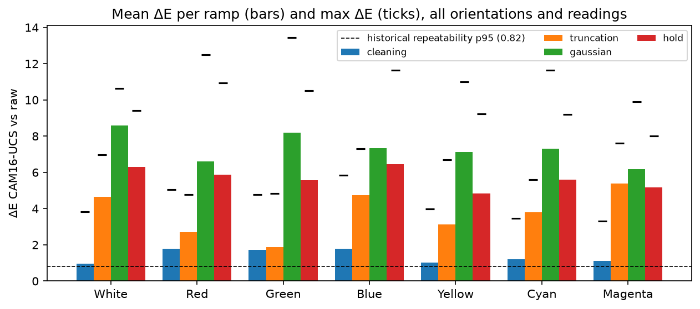

*Figure 18. Mean ΔE (bars) and max ΔE (ticks) per ramp and method, against the raw data. The dashed line is the historical repeatability p95 after section 3 cleaning (ΔE 0.82), not a significance threshold. Produced by `scripts/6_compare_methods.py`.*

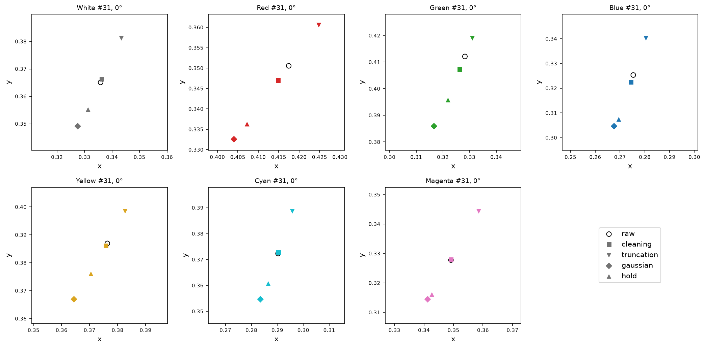

*Figure 19. Chromaticity of reading 31 at 0°, one zoomed panel per ramp: raw data (circle) and the four methods. Produced by `scripts/6_compare_methods.py`.*

What the comparison shows:

- **Reconstruction changes are often larger than historical repeat differences after cleaning.** Truncation changes 97 % of spectra by more than the reference of 0.82; Gaussian and hold change all of them by more. This puts the size of the changes in context, without establishing their statistical significance or correctness.
- **The methods move colours in opposite directions** (Figure 19). Truncation moves every colour towards yellow. Gaussian and hold move it towards blue. Cleaning stays close to the raw data, because it keeps the contaminated bands.
- **Truncation and hold set the range.** If the true reflectance below 440 nm lies anywhere between 0 and the value at 440 nm, the true colour lies between these two methods. They are 9.43 ΔE apart on average, about eleven and a half times the historical repeatability reference after cleaning. **This illustrates reconstruction uncertainty under those assumptions, not a statistical confidence interval.**
- **Gaussian and hold agree in XYZ** (mean ΔE 1.68). They arrive there by very different routes: the Gaussian through impossible reflectance, hold through a plausible one.

**Choice: hold.** It is the only method that:

1. replaces all the contaminated bands;
2. never implies an impossible reflectance;
3. uses the same reflectance for X, Y and Z;
4. needs no fitting and no free parameters.

Hold sits at the upper end of the plausible range. If future measurements show that the screen absorbs below 440 nm, the true Z will be lower, towards truncation.

## 7 Conclusions

1. **The ColorMunki Photo does not measure below 440 nm on this screen.** Up to 420 nm it returns a flat, mostly negative line that follows the patch brightness. Between 420 and 437 nm that line still leaks into the signal.
2. **The damage is in X and Z, not in Y.** Below 440 nm lies 20.4 % of Z and 3.6 % of X for a uniform reflector under D50, against 0.1 % of Y. Above 700 nm the instrument is noisy, but the region contributes at most 0.13 % and can be ignored.
3. **The cutoff is 440 nm.** It is the lowest band where the baseline leak drops to the background level of the estimate (below 5 %).
4. **Cleaning alone is not enough.** It removes impossible values but keeps contaminated bands.
5. **Truncation is a lower bound.** It assumes the reflectance drops to zero in one step, which no real material does.
6. **Gaussian extrapolation is rejected.** It implies reflectance above 1 in two thirds of the spectra.
7. **Hold is recommended.** It is simple, always physically possible and consistent across X, Y and Z.
8. **The reconstruction uncertainty is large.** Truncation and hold differ by 9.43 ΔE on average, compared with a historical repeatability p95 after cleaning of 0.82. The former describes disagreement between reconstruction assumptions; the latter describes repeated measurements after section 3 cleaning. Neither establishes the true spectrum below 440 nm.
9. **Keep acquisition conditions consistent.** The method results are reported separately for each instrument orientation. Assess a correction within the same acquisition geometry rather than mixing datasets.

## 8 Limitations and open questions

- **No ground truth.** No method can be proven correct without a reference measurement of the same screen below 440 nm, for example with a spectroradiometer or a spectrophotometer whose range covers 380 nm reliably. Such a measurement would also decide where the truth lies between truncation and hold.
- **Polarizer or instrument?** The common drop below 437 nm (section 4.2) could be an instrument artefact or a real absorption in the polarizer or the screen protector. If it is real, hold overestimates Z.
- **Screen protector.** It was not removed. Its transmission below 440 nm is unknown and is included in every measurement.
- **Orientation dependence.** The per-orientation results in sections 3 and 5 differ. It is still open which acquisition geometry, if any, represents how the screen is seen in normal use.
- **Repeatability reference.** The five-reading patch blocks come from May greyscale measurements, not the November colour ramps. Their pooled p95 of 0.82 describes repeatability after section 3 cleaning, not the variability of the raw exports. It is an empirical reference, not a verified noise floor for every patch, a significance test or an accuracy estimate (see [section 2.3](#23-noise-floor)).
- **Zone thresholds.** The 5 %, 10 % and 25 % leak thresholds are judgement calls. The 5 % threshold is anchored to the background level of the estimate. The other two only separate degrees of contamination and do not affect the cutoff.
- **Gaussian method.** Y was not reconstructed. This does not change the verdict, because it accounts for only 0.1 % of Y.
- **Above 700 nm.** The instability was not corrected, because its effect on XYZ is negligible (Table 1). It would matter for observers or illuminants with more weight in the deep red.
- **One console.** The analysis covers a single Game Boy Color. Other handhelds measured with the same instrument share the 440 nm limit, but the size of the effect depends on each screen's blue reflectance.

## 9 References

- CIE 015:2018, *Colorimetry*, 4th edition. Commission Internationale de l'Éclairage, 2018. Colour matching functions, D50 and the computation of XYZ.
- C. Li, Z. Li, Z. Wang, Y. Xu, M. R. Luo, G. Cui, M. Melgosa, M. H. Brill, M. Pointer, "Comprehensive color solutions: CAM16, CAT16, and CAM16-UCS", *Color Research & Application*, 42(6), 703–718, 2017. [doi:10.1002/col.22131](https://doi.org/10.1002/col.22131).
- IEC 61966-2-1:1999, *Multimedia systems and equipment – Colour measurement and management – Part 2-1: Default RGB colour space – sRGB*.
- Colour developers, *Colour*, Python library for colour science, version 0.4.7. [colour-science.org](https://www.colour-science.org/).
- SciPy developers, `scipy.optimize.curve_fit`. [docs.scipy.org](https://docs.scipy.org/doc/scipy/reference/generated/scipy.optimize.curve_fit.html).
- G. Gill, *ArgyllCMS*, `spotread`. [argyllcms.com](https://www.argyllcms.com/doc/spotread.html).
